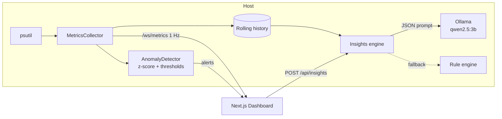
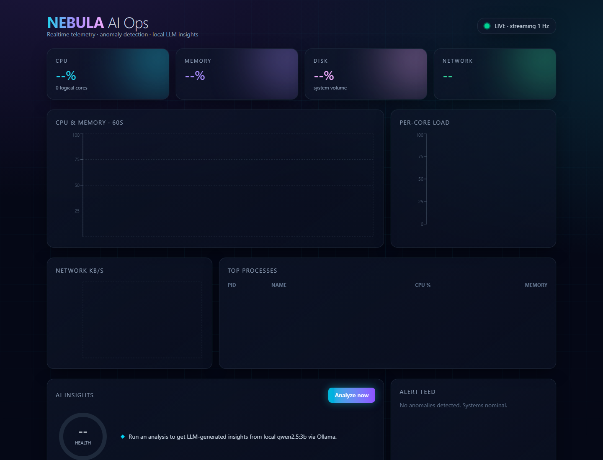

<div align="center">

# 🌌 NEBULA · AI Ops

**Realtime system observability with anomaly detection and local-LLM insights.**


</div>

---

## ✨ Features

- ⚡ **Live telemetry at 1 Hz** over WebSocket: CPU (total + per-core), RAM, disk, network up/down
- 🚨 **Anomaly detection**: rolling z-score (60-sample window) plus static critical thresholds, streamed into an alert feed
- 🧠 **AI Insights**: summarises recent metrics, asks a **local** `qwen2.5:3b` (Ollama, JSON mode) for 3 insights and a health score
- 🛟 **Graceful fallback**: rule-based insights when Ollama is offline or slow
- 🎨 **Futuristic UI**: glassmorphism, neon cyan/violet gradients, animated glow, grid backdrop, responsive layout
- 🧮 **Top processes** (top 8 by CPU and memory), refreshed every 3 s over the WebSocket and at `/api/processes`
- 🖥️ **System info card**: hostname, OS, CPU model and cores, total RAM, uptime, boot time
- 🎚️ **Configurable alert thresholds** (CPU / RAM / disk) via a settings panel and `GET/PUT /api/settings`
- 🕒 **Alert history timeline** with severity colors and a clear button
- 💬 **Ask Nebula AI**: chat about the current system state (Ollama, rule-based fallback)
- 📤 **Export** metrics history as CSV or JSON
- ⏱️ **Time-range toggle** on charts: 1m / 5m / 10m (600-sample history)
- ✅ **Tested and CI-ready**: pytest, ruff, Next.js typecheck and build in GitHub Actions

## 🏗 Architecture



## 🚀 Quick start

```powershell
# backend
cd backend; uv sync; uv run uvicorn app.main:app --port 8010
# frontend
cd frontend; npm install; npm run build; npm run start   # http://localhost:3010
# or both, hidden:
./start.ps1
```

Optional: `ollama pull qwen2.5:3b` for AI insights (otherwise rule-based insights are used).

| Endpoint | Description |
|---|---|
| `GET /health` | Liveness and version |
| `GET /api/snapshot` | One metrics snapshot |
| `GET /api/processes` | Top 8 processes (name, pid, cpu %, mem MB) |
| `GET /api/system` | Host info: hostname, OS, CPU, RAM, uptime, boot time |
| `GET /api/alerts` | Alert history |
| `DELETE /api/alerts` | Clear alert history |
| `GET /api/settings` | Current alert thresholds |
| `PUT /api/settings` | Update thresholds (`cpu_threshold`, `ram_threshold`, `disk_threshold`, 1-100) |
| `POST /api/insights` | AI (or fallback) insights and health score |
| `POST /api/ask` | `{"question": "..."}` → answer about current system state |
| `GET /api/export?format=csv\|json` | Download metrics history (up to 600 samples) |
| `WS /ws/metrics` | 1 Hz metric stream (system info first, processes every 3 s) |

## 📸 Screenshots



## 🧪 Tests

```powershell
cd backend; uv run ruff check .; uv run pytest -q
cd frontend; npm run typecheck; npm run build
```

## 📄 License

MIT © Haris Mughal

## Streamlit edition

A pure-Python version of the dashboard (Streamlit, psutil, Plotly). It runs locally and on Streamlit Community Cloud, and falls back to rule-based AI answers when Ollama is not available. See [streamlit-app/](streamlit-app/) and its [README](streamlit-app/README.md).

```powershell
pip install -r streamlit-app/requirements.txt
streamlit run streamlit-app/app.py
```

